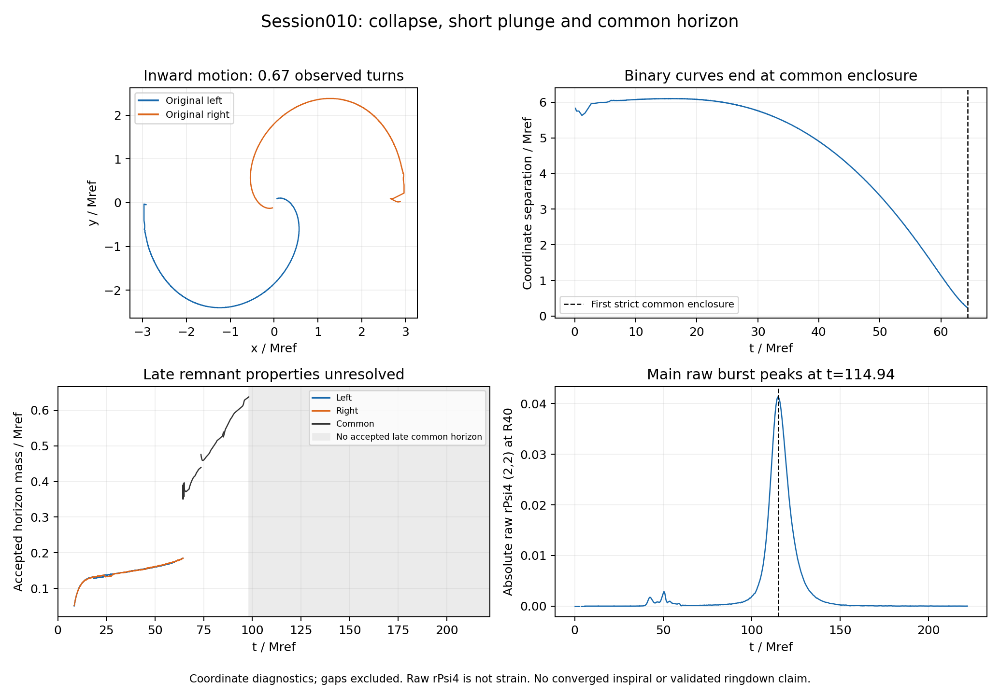

# Session010 Vista results, reconciled on Perseus

The supplied October 19 summary records evolution to t=221.953125 Mref, two
individual horizons near 8.43/8.49, and strict common enclosure at 64.36875.
Observed pre-common motion is 0.670424 turns excluding gaps: short inward
motion/plunge, without a demonstrated long quasi-circular inspiral. The raw
R40 (2,2) burst peaks at 114.9391. Common-horizon quality fails after 98.1984;
final remnant mass/spin and validated ringdown remain unresolved.



[Overview PDF](00_scientific_summary.pdf) · [Science report](session_reports/REPORT.md) ·
[Technical report](session_reports/REPORT_AGENT.md) · [Measured values](receipts/SCIENTIFIC_RECHECK.json).

Canonical session root on Perseus:
`/data/jiaxiwu/NRPIC/GI_in_cluster/session_010_vista_preparation_20261013`.
Its root reports and plots/movies/config/input/reduced-data/script folders are
the portable archive entry points. Git report snapshots link to those canonical
Perseus paths because large arrays, movies, caches and raw data stay off Git.
The supplied `session010_summary_20261019/` remains byte-preserved there.
This compact Git package includes original small Vista scripts/configs and
reports, the new plotting/recheck code, overview and verification receipts.

Native as-run commit: `386870f88f60e25e1a8fac76fe04a071b87a01cf`.
Kokkos: `6739bc623081648af9e752b616d9671527922cbf`.
This results commit changes no native source, input physics or numerical method.
The newer scheduler snapshot records 1075832 completed and 1075833 cancelled
unallocated; older queued-continuation notes are historical. No live Vista
query, production submission, raw transfer or deletion occurred here.

Slurm 17024 verified 4,044 files (8.681 GiB), copied 163 products by SHA256,
rechecked science and fully decoded all six current/historical MP4s. Slurm
17032 rehashed all copied destinations, checked canonical links, verified eight
PNG/PDF pairs and independently reproduced the overview identically. See
[completion](receipts/COMPLETE.json), [final audit](receipts/FINAL_AUDIT.json),
[promotion manifest](receipts/PROMOTION_MANIFEST.json) and
[scheduler snapshot](receipts/SCHEDULER_SNAPSHOT.json).

To replot the new overview without overwriting the release, use an allocated
Perseus Slurm job with NumPy, Matplotlib and an unused output prefix:

```sh
export MPLBACKEND=Agg OMP_NUM_THREADS=1 OPENBLAS_NUM_THREADS=1
python3 reconcile.py --session /path/to/session_010_vista_preparation_20261013 \
  --replot-to /path/to/new_review/00_scientific_summary
```

The original full promotion and final-audit entry points intentionally refuse
completed destinations. Preserved Vista launch scripts retain historical
absolute paths and machine guards; review before reuse. Do not run the ARM
binary on Perseus. Full original rendering also needs the native raw data,
which the summary omits. Roughly 2.1 TB is listed on Vista scratch; independent
Anta raw archival is not demonstrated by this summary.
